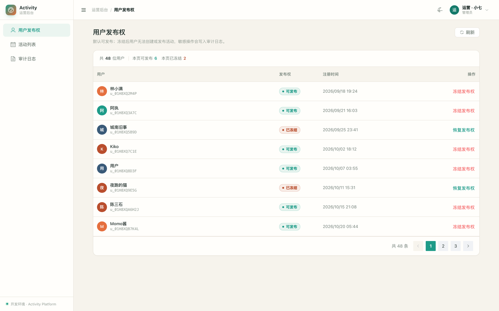

# 运营后台（apps/admin）UI 规范 v1.0

> 设计风格：**暖调运营控制台（Operations Console）**，配色与小程序品牌同源
> 关键词：清晰、克制、信息密度适中、暖米白 + 青绿、深浅色一致、零新增运行时依赖。
> 适用范围：`apps/admin` 全部页面。小程序视觉见 [mp-urban-editorial.md](./mp-urban-editorial.md)，两者不共用 token。



## 1. 设计原则

- **信息优先**：列表页第一屏必须能看到对象、状态、时间和处置动作。
- **状态用「胶囊 + 圆点」表达**，不用大面积色块，避免表格花。
- **一个页面一个主操作**：查询/刷新在页头，行内操作只放业务动作（冻结 / 恢复 / 下架）。
- **零新增依赖**：不引入 UnoCSS / Tailwind / Pinia / SCSS，全部用原生 CSS 变量 + 原生 CSS。
- **深浅色同源**：所有颜色只经 CSS 变量取值，切换 `html.dark` 即整套换肤。

## 2. 结构

```text
src/
  layouts/AdminLayout.vue      # 壳：侧边栏 + 顶栏（面包屑/主题/用户菜单）+ 内容区
  components/
    SidebarNav.vue             # 品牌区 + el-menu（router 模式）+ 环境标识
    PageHeader.vue             # 页标题 + 描述 + 右侧动作插槽
    ProTableLite.vue           # 列表页容器：工具栏 / 表格 / 空态 / 分页
    SearchForm.vue             # 组合查询栏：字段插槽 + 查询/重置
    StatusPill.vue             # 状态胶囊：ok / warn / danger / info / neutral
    UserIdentity.vue           # 头像 + 名称 + 编号（用户 / 主办 / 操作人复用）
  composables/useTable.ts      # 列表状态机：loading / rows / 分页 / 错误
  permissions.ts               # 能力表：角色 → capability，can / hasRole / usePermission
  directives/auth.ts           # v-auth：无能力时移除元素
  composables/useTheme.ts      # 深浅色状态 + localStorage 持久化
  navigation.ts                # 菜单定义（含按角色过滤）
  utils/format.ts              # 时间、金额、展示名、头像色
  utils/errors.ts              # 取数错误统一处理（401 跳登录 / 403 跳默认页 / 提示）
  styles/index.css             # design tokens + Element Plus 变量覆盖 + 通用类
  views/                       # 4 个业务页，只负责数据与列定义
```

路由：业务页作为 `AdminLayout` 的 children 挂在 `/` 下，`meta.title` 同时驱动面包屑与 `document.title`；角色限制继续用 `meta.roles`，守卫逻辑不变。

## 3. Design Tokens

定义在 `src/styles/index.css` 的 `:root` 与 `html.dark`，颜色只允许通过变量使用。

| Token | Light | Dark | 用途 |
| --- | --- | --- | --- |
| `--brand-500` | `#1e9b88` | `#3fbfa8` | 主色：按钮、选中态、链接（对齐小程序 `color.brand`） |
| `--brand-600` | `#157a6a` | `#2aa391` | 主色深阶 |
| `--brand-accent` | `#e56f3e` | `#f08a5f` | 强调色（品牌标记渐变第二色） |
| `--brand-050` | `rgba(30,155,136,.09)` | `rgba(63,191,168,.12)` | 选中底色 |
| `--bg-app` | `#f6f3ec` | `#14120e` | 页面底色（暖米白 / 暖黑） |
| `--bg-surface` | `#fffefb` | `#1c1a15` | 卡片 / 侧边栏 / 顶栏 |
| `--bg-surface-muted` | `#f7f4ed` | `#24211a` | 表头、次级区块 |
| `--border` | `#e7e2d9` | `#322e26` | 分隔线、面板描边 |
| `--text-primary` | `#24312d` | `#ece7dd` | 标题、正文 |
| `--text-secondary` | `#77837a` | `#b3aba0` | 次级信息 |
| `--text-muted` | `#929b92` | `#8c8578` | 说明文字、占位 |
| `--success` / `--warning` / `--danger` | `#1e9b88` / `#e56f3e` / `#b94e2d` | `#3fbfa8` / `#f0a05a` / `#e07a5f` | 状态语义（绿 / 陶土橙 / 深陶土） |
| `--radius-sm/md/lg` | 8 / 10 / 14 px | — | 控件 / 卡片 / 面板 |
| `--shadow-sm/md` | 两组极轻阴影 | — | 卡片 / 浮层 |

Element Plus 通过 `--el-*` 覆盖接入：`--el-color-primary` 及 4 个 light 阶、`--el-border-radius-base`、表格相关变量等，不改组件内部样式。

### 3.1 配色决策：与小程序品牌一致（B 方案，已确认）

后台默认配色**对齐小程序品牌**（青绿 `#1E9B88` + 陶土橙 `#E56F3E`），色值取自 [mp-urban-editorial.md](./mp-urban-editorial.md)；后台额外使用暖米白底与暖黑深色底，与小程序「城市生活编辑部」的暖调保持同一气质。

> 若后续运营希望后台更「工具化」，可只替换 `:root` / `html.dark` 的变量块切回冷调蓝（`--brand-500:#3b6ef6`、`--bg-app:#f4f6fb`、`--bg-surface:#ffffff`、`--el-color-primary:#3b6ef6` 等），业务代码零改动。

**注意**：Element Plus 的 `dark/css-vars.css` 用 `html.dark` 声明 `--el-color-primary`，优先级高于 `:root`。因此暗色主色必须在 `html.dark` 里重新声明（本仓库已在 token 块中处理），否则暗色下按钮/分页会回落到 EP 默认蓝。

## 4. 页面骨架与列表范式

列表页统一由 `PageHeader` + `ProTableLite` 组成，页面本身只写「取数 + 列定义 + 行内动作」：

```vue
<PageHeader title="用户发布权" description="…">
  <template #actions>
    <el-button :icon="Refresh" :loading="loading" @click="refresh">刷新</el-button>
  </template>
</PageHeader>

<ProTableLite
  :data="rows" :loading="loading" row-key="id" empty-text="暂无用户"
  paged :page="page" :page-size="pageSize" :total="total"
  @page-change="goPage"
>
  <template #toolbar>…统计…</template>
  <el-table-column … />            <!-- 列通过默认插槽传入 -->
</ProTableLite>
```

```ts
const { rows, loading, page, pageSize, total, goPage, refresh } = useTable({
  fetch: ({ page }) => listUsers(page),
  onError: (error) => handleListError(error, router, "加载失败"),
});
```

约定：

- 页头描述写「这一页能做什么 + 有什么后果」，不写功能罗列。
- 列表页统计放进 `#toolbar`（总数、本页可发布/已冻结等），不额外占用页头。
- **筛选归属**：多字段组合查询用 `SearchForm` 放进 `#toolbar`，条件先落表单、点「查询」才发请求（如审计日志）；单字段的「视图切换」筛选（如活动生命周期）放在页头动作区，切换即时生效。
- 行内操作列 `fixed="right"`，窄屏时动作始终可见。
- 数据为空由 `ProTableLite` 统一渲染 `el-empty`；加载由它统一 `v-loading`。
- 分页接口传 `paged`，一次性接口（如活动列表）省略；`useTable` 同时支持 `Row[]` 与 `{ items, total }` 两种返回形态。
- 翻页/筛选/处置成功后统一 `goPage(n)` / `refresh()`，不要自己维护 `loading`。
- 401 / 403 / 后端 message 全部走 `handleListError`。

## 5. 组件规范

| 组件 | 规则 |
| --- | --- |
| `StatusPill` | 状态文案 + 圆点；`tone` 与语义绑定：可发布/已发布 `ok`，已冻结/已下架 `danger`，已取消/下架操作 `warn`，草稿 `neutral` |
| `UserIdentity` | 头像取名字首字，底色由名字哈希稳定生成；副标题放 ID / 邮箱 |
| `PageHeader` | 标题 h1，描述 13px muted；动作区只放 1–2 个按钮或一个筛选器 |
| 表格 | 表头 12.5px、大写字母间距仅对西文生效；单元格主副两行用 `.cell-stack` |
| `ProTableLite` | 只负责容器与分页，不接管取数；列由默认插槽传入，工具栏走 `#toolbar`；`paged` 控制是否渲染分页 |
| `useTable` | 承接 loading / rows / 分页 / 错误；`fetch` 返回数组或 `{ items, total }` 均可 |
| `SearchForm` | 字段插槽 + 统一「查询 / 重置」；表单态与已应用态分离，避免边改边请求 |
| 时间 | 精确时间 `YYYY/MM/DD HH:mm`；审计日志额外显示相对时间并用 tooltip 兜底 |
| 金额 | `免费` 或 `¥12.00`，走 `formatFee` |

## 6. 响应式

- `> 900px`：侧边栏常驻，可折叠为 76px 图标栏（折叠状态写 localStorage）。
- `≤ 900px`：侧边栏变 `el-drawer`，顶栏汉堡按钮唤出；用户菜单只保留头像。
- 表格窄屏横向滚动，操作列 `fixed="right"`。
- 登录页 `≤ 960px` 隐藏左侧品牌区，仅留表单。

## 7. 深色模式

- 顶栏月亮/太阳按钮切换 `html.dark`，选择写入 `localStorage.admin_theme`，未设置时跟随 `prefers-color-scheme`。
- `main.ts` 在挂载前调用 `initTheme()`，避免首屏闪白。
- 新增颜色时必须同时提供 light / dark 两个值，否则视为破坏规范。

## 8. 可访问性

- 所有图标按钮带 `aria-label`；面包屑用 `<nav aria-label="面包屑">`。
- 表格行内操作使用文字按钮，不依赖颜色区分。
- 状态胶囊的圆点只是增强，文案本身已表达状态。

## 9. 权限（PR4）

前端权限只有一层：**能力（capability）**。角色不直接出现在页面里，改权限只改 `permissions.ts` 的映射表。

| Capability | admin | operator | 用途 |
| --- | :---: | :---: | --- |
| `audit:read` | ✅ | — | 查看审计日志（菜单 + 路由 + 页面） |
| `user:publish:manage` | ✅ | ✅ | 冻结 / 恢复发布权按钮 |
| `activity:remove` | ✅ | ✅ | 下架活动按钮 |

三种用法，同一份数据源：

```ts
// 1. 路由：meta.capability + 全局守卫
meta: { title: "审计日志", capability: Capability.AuditRead }

// 2. 菜单：navigation.ts 的 capability，SidebarNav 用 can() 过滤
{ path: "/audit-logs", title: "审计日志", capability: Capability.AuditRead }

// 3. 按钮：指令，无能力时从 DOM 移除（不是 display:none）
<el-button v-auth="Capability.RemoveActivity">下架</el-button>
<el-button v-auth="[Capability.RemoveActivity, Capability.ManagePublish]">任一即可</el-button>
```

页面内需要判断时用 `usePermission()`（`can / canAll / hasRole / isAdmin`）。

约定：

- **只给「超出默认权限」的页面加路由 capability**（当前仅审计日志），默认页不加，避免没有兜底页时出现重定向环；后端只签发 operator / admin 两种角色。
- 前端权限只是入口保护和交互保护，**不是安全边界**：接口鉴权仍以后端 Guard 为准（ADR-0004）。
- 未知角色默认无任何能力（fail closed）。

## 10. 与后端契约的关系

UI 改造**不改** `src/api/*`、请求头、分页参数和路由守卫逻辑；`token` / `profile` 仍存 `localStorage`，401 时清理并跳登录。

已落地的增量：PR1 布局壳、PR2 主题 token、PR3 `ProTableLite` + `useTable`、PR4 `v-auth` + 能力表、PR5 骨架收敛（`SearchForm` + 审计日志接入同一套列表范式）。剩余只有可选的 PR6 pinia `useAuthStore`。计划与触发条件见 [选型调研](../research/element-plus-admin-frameworks-2025.md) 第 7.7 节。
